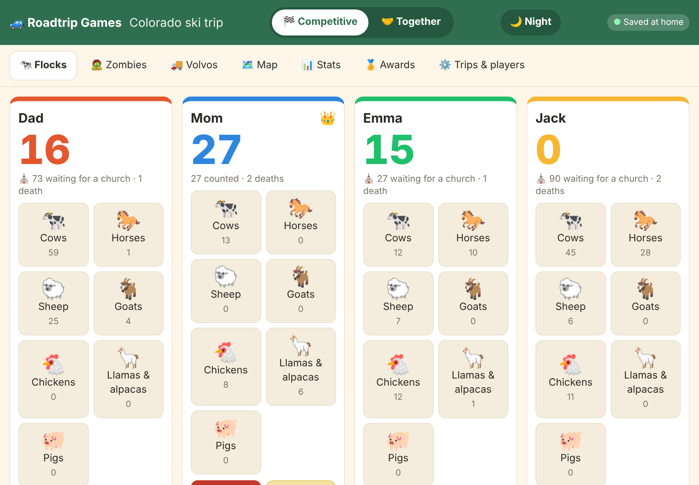
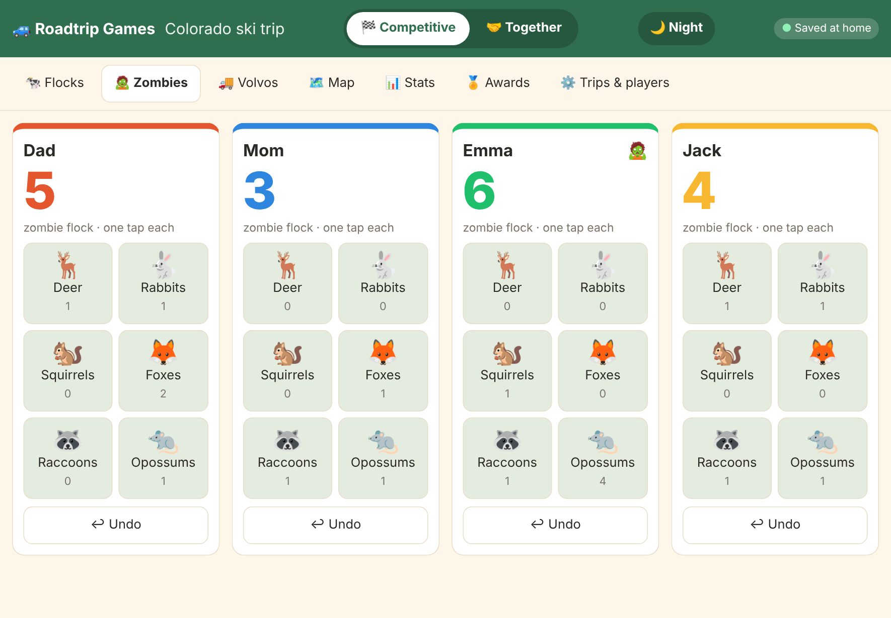
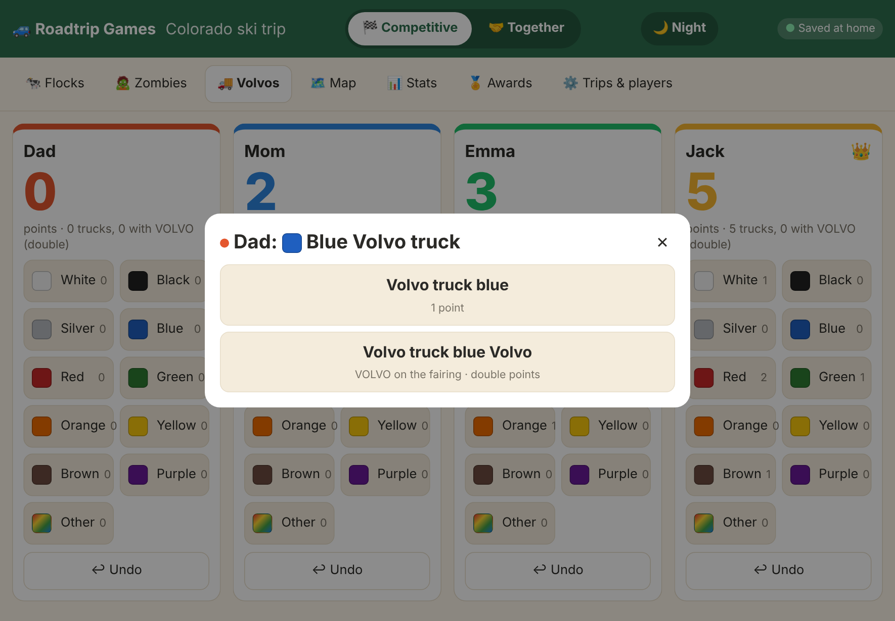
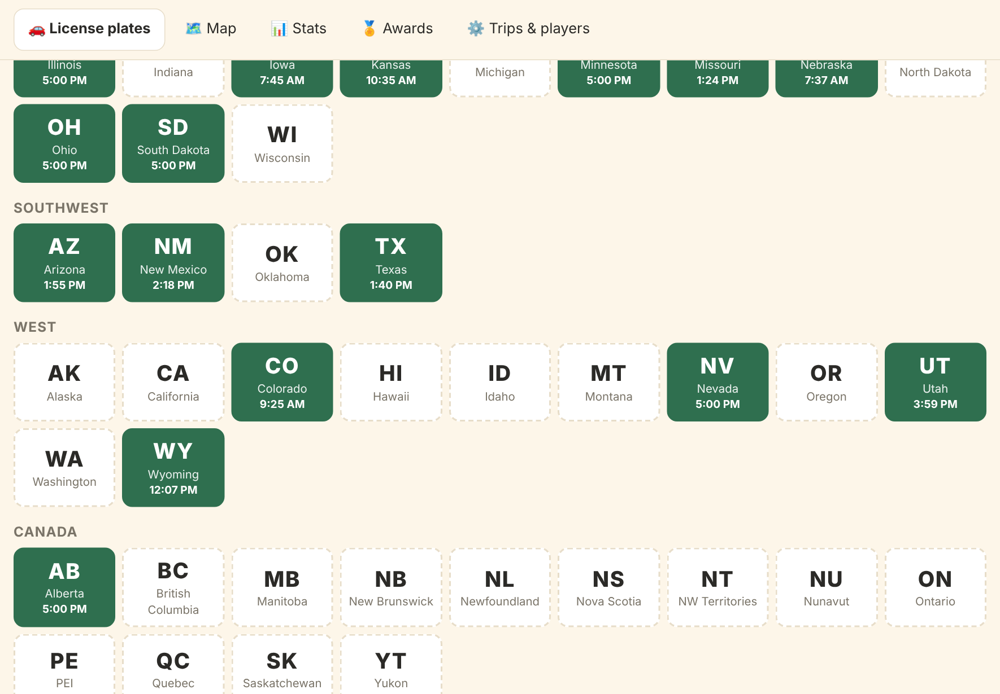
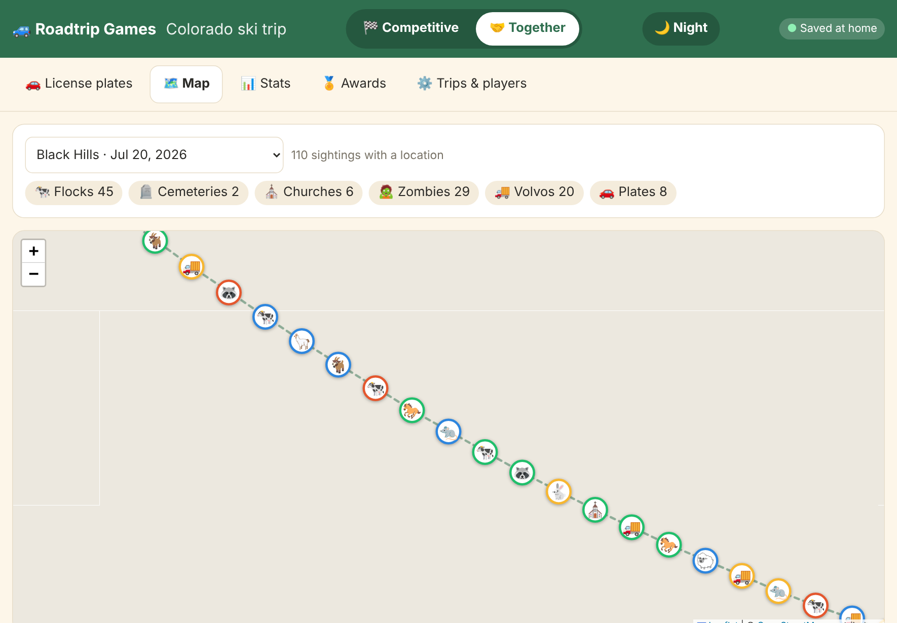
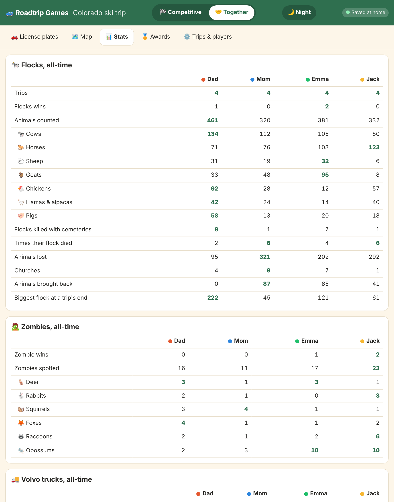
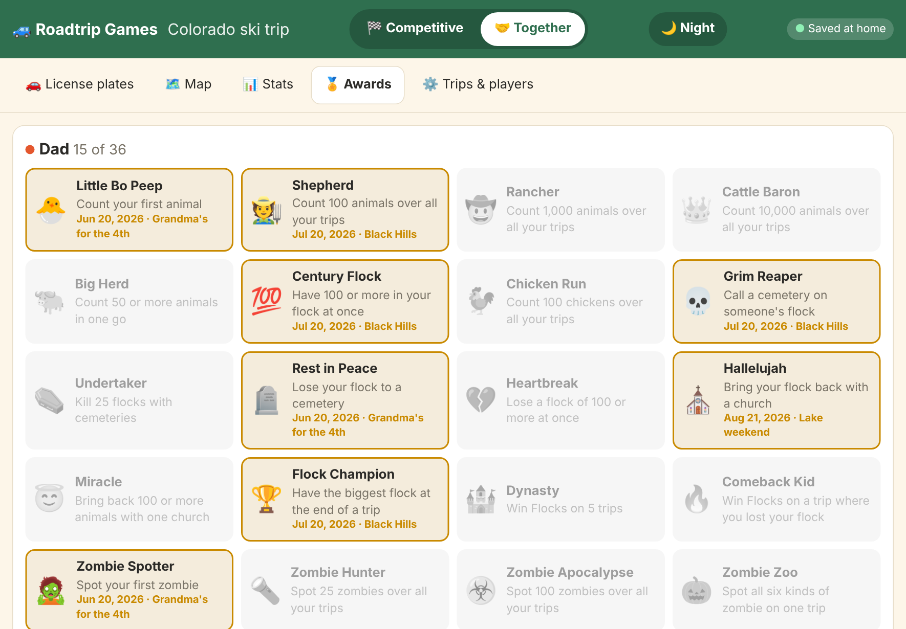
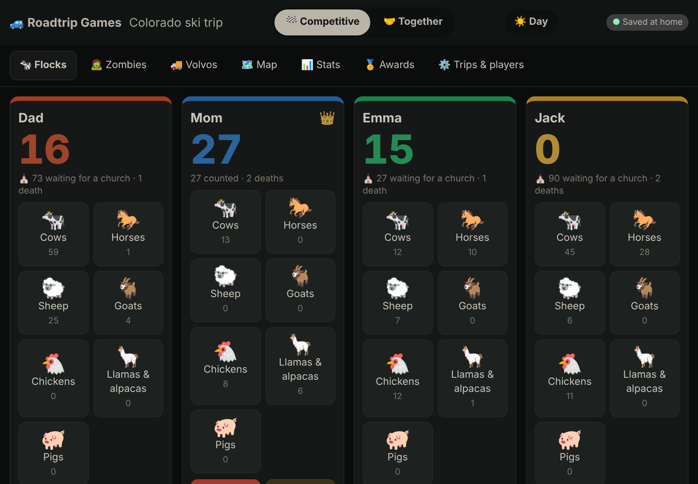
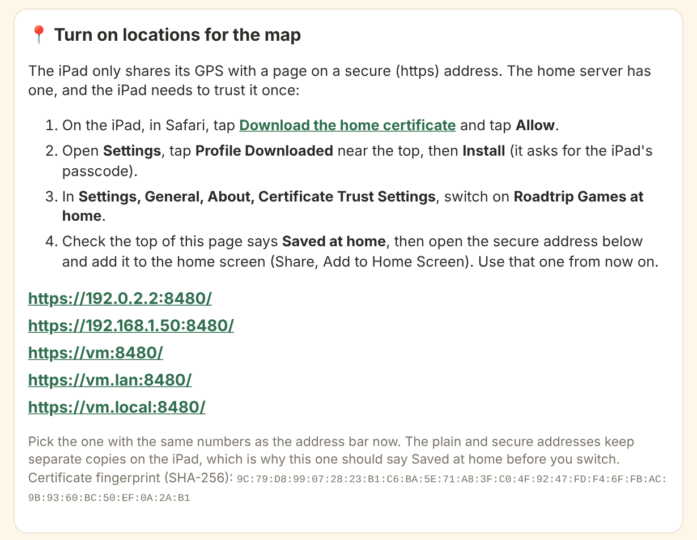

# Roadtrip Games 🚙

**The car games your family already plays, scored on an iPad and remembered forever.**

Roadtrip Games keeps score for **Flocks**, **Zombie Flocks**, **Volvo trucks** and the **license plate game**. Every sighting is pinned on a map of the trip, and all-time stats and awards pile up across every trip you take.



It's one small program that runs at home on a Windows PC, a Mac, a Raspberry Pi or a Docker server such as Unraid. The iPad opens it in Safari like a website, but it keeps working in a dead zone. Every tap is saved on the iPad first and sent home whenever the iPad can reach your server, either on your Wi-Fi or from the car over cell with a VPN such as WireGuard. Nothing goes to anyone else's cloud.

> This is a hobby project, **developed with AI** (Claude, by Anthropic). Use it at your own risk; there's no warranty. Licensed under GPL-3.0.

## Contents

- [The games](#the-games)
- [Trip map](#trip-map)
- [Stats and awards](#stats-and-awards)
- [Night mode](#night-mode)
- [Installing](#installing): [Windows](#windows), [Docker Compose](#docker-compose), [Unraid](#unraid)
- [Setting up the iPad](#setting-up-the-ipad)
- [Backups](#backups)
- [For the curious](#for-the-curious)

## The games

Up to four players. The switch at the top of the screen flips between the **Competitive** games and the **Together** game.

### 🐄 Flocks (competitive)

Count the livestock you see: cows, horses, sheep, goats, chickens, llamas & alpacas, and pigs. Tap the animal, then tap how many.

- **🪦 Cemetery:** whoever spots one taps **Cemetery** on their own panel and picks whose flocks die. Everyone else is ticked to start with. Those flocks drop to zero.
- **⛪ Church:** whoever spots one taps **Church** on their own panel and gets back everything they've lost to cemeteries since their last church.
- When you end the trip, the biggest flock wins.

### 🧟 Zombie Flocks (competitive)

Roadkill makes up your zombie flock: deer, rabbits, squirrels, foxes, raccoons and opossums. One tap counts one. They're already dead, so cemeteries and churches leave them alone. The biggest zombie flock wins the trip.



### 🚚 Volvo trucks (competitive)

Tap the colour of the Volvo truck, then choose **"Volvo truck blue"** (1 point) or, if VOLVO is written on the cab fairing, **"Volvo truck blue Volvo"** (double, 2 points). The most points wins the trip.



Each panel's **↩ Undo** takes back that player's last tap in that game.

### 🚗 License plates (together)

The whole car plays as one team. Tap a state or province the moment anyone sees it, and the tile shows when you found it. All 50 states, Washington DC and the Canadian provinces and territories are there. Tap a found plate to take it back.



## Trip map

When the iPad uses the home server's secure address (see [Setting up the iPad](#setting-up-the-ipad)), every cow count, cemetery, church, zombie, Volvo and plate is saved with where it happened. The **Map** tab shows any trip on a free OpenStreetMap map. Pins are coloured by player, and tapping one shows who saw what, and when. Viewing the map needs internet for the map pictures; recording locations doesn't.



*(The street map is left out of this screenshot; in the app the pins sit on an OpenStreetMap map.)*

## Stats and awards

**Stats** shows each player's all-time numbers for every game: animals by kind, flocks killed with cemeteries, times their flock died, animals lost and brought back, zombies by kind, and Volvos by colour. It also shows every plate your car has ever found and a list of past trips with each game's winner.



**Awards** shows all 36 awards for each player, earned or not, with when and on which trip each was won. A pop-up announces each one the moment it's earned. Some favourites: *Grim Reaper*, *Heartbreak* (lose a flock of 100), *Hallelujah*, *Miracle* (a church brings back 100), *Comeback Kid*, *Zombie Zoo*, *Say It Twice*, *Rainbow Fleet*, *Coast to Coast* and *Fifty Club*.



## Night mode

The **🌙 Night** button at the top dims the whole page, map included, so the iPad doesn't light up the car or blind the driver after dark. **☀️ Day** switches back. Until you press it, the page follows the iPad's own light or dark setting.



## Installing

The program needs to run on something that stays on at home. It uses two ports: **8070** for the plain address and **8443** for the secure address (needed for GPS on the iPad).

### Windows

1. Download `roadtrip-games-windows.zip` from the latest build. On the repository's **Actions** tab, open the newest **build** run and download it under **Artifacts**. Once there are releases, it's also on the [Releases page](https://github.com/jsttylr/Flocks_and_other_roadtrip_games/releases).
2. Right-click the zip, choose **Extract All**, and put the folder somewhere permanent, for example `C:\RoadtripGames\`.
3. Double-click `roadtrip-games.exe`. If Windows says "Windows protected your PC", click **More info**, then **Run anyway**.
4. When Windows Firewall asks, tick **Private networks** and click **Allow**.
5. Your browser opens the page. There's no program window; it runs in the background. The history is kept in the `data` folder next to the program.

Mac and Linux builds (including a Raspberry Pi one) are in the same download.

### Getting the Docker image

GitHub builds the Docker image on every change and stores it at `ghcr.io/jsttylr/flocks_and_other_roadtrip_games`. The tag `main` is always the newest build.

This repository is private, so the image starts out private too, and Docker would need your GitHub login to download it. The easiest fix is to make just the image public. It contains only the finished program, not this code. On GitHub, go to your profile, **Packages**, **flocks_and_other_roadtrip_games**, **Package settings**, then under **Danger Zone** choose **Change visibility** and pick **Public**.

If you'd rather keep it private, log in once on the Docker machine with `docker login ghcr.io`, using your GitHub username and a [personal access token](https://github.com/settings/tokens) with the `read:packages` permission as the password.

### Docker Compose

1. Copy [`docker-compose.yml`](docker-compose.yml) to the Docker machine, for example into a `roadtrip-games` folder.
2. Change `ROADTRIP_HOSTS` to the address the iPad uses to reach that machine, for example `192.168.1.50`. Docker hides the machine's real address from the program, so it needs telling, or the secure address won't work. If you reach home over WireGuard with a different address, add it after a comma.
3. Start it:

   ```sh
   docker compose up -d
   ```

4. Open `http://<the machine's address>:8070` and carry on with [Setting up the iPad](#setting-up-the-ipad).

To update later:

```sh
docker compose pull && docker compose up -d
```

The history lives in the `roadtrip-data` Docker volume, so updates never touch it.

Without Compose, the same thing in one command:

```sh
docker run -d --name roadtrip-games --restart unless-stopped \
  -p 8070:8070 -p 8443:8443 \
  -e ROADTRIP_HOSTS=192.168.1.50 -e TZ=America/Chicago \
  -v roadtrip-data:/data \
  ghcr.io/jsttylr/flocks_and_other_roadtrip_games:main
```

### Unraid

Unraid can install it from a template, so you don't have to type the settings yourself.

1. Make the image public first (see [Getting the Docker image](#getting-the-docker-image)). Unraid forgets a `docker login` every time it reboots, so a private image would stop updating.
2. Download [`unraid/roadtrip-games.xml`](unraid/roadtrip-games.xml) from this repository.
3. From another computer, open the Unraid flash share (`\\tower\flash` on Windows, `smb://tower/flash` on a Mac), and copy the file into `config/plugins/dockerMan/templates-user/`, renamed `my-roadtrip-games.xml`. (If the flash share isn't shared, turn it on under **Main**, **Flash**, **SMB Security Settings**, or copy the file there with the Unraid terminal.)
4. In the Unraid web page, open the **Docker** tab, click **Add Container**, and pick **roadtrip-games** from the **Template** list under *User templates*.
5. Check the settings:
   - **Web page** `8070` and **Secure web page (GPS)** `8443`. Change the left-hand numbers only if something else already uses them.
   - **Game history** `/mnt/user/appdata/roadtrip-games`, where every trip is kept.
   - **Server address for the iPad**: your Unraid server's IP address (shown at the top of the Unraid page), plus `tower.local` or your server's name. If you reach home with Unraid's built-in WireGuard and the iPad uses a different address over the tunnel, add that too, separated by a comma.
6. Click **Apply**. When it's running, click the container's icon and choose **WebUI** to open it, then carry on with [Setting up the iPad](#setting-up-the-ipad).

To update, use **Check for Updates** on the Docker tab, then **Apply Update**. Include `/mnt/user/appdata/roadtrip-games` in your appdata backups.

With no template, **Add Container** works by hand: Repository `ghcr.io/jsttylr/flocks_and_other_roadtrip_games:main`, Network type `bridge`, then **Add another Path, Port, Variable** for port 8070, port 8443, path `/data` → `/mnt/user/appdata/roadtrip-games`, and variable `ROADTRIP_HOSTS` → your server's address.

## Setting up the iPad

Do this once, at home on your Wi-Fi.

1. Open Safari and go to the plain address, `http://<server address>:8070`, for example `http://192.168.1.50:8070`.
2. Tap **⚙️ Trips & players**. The **Turn on locations for the map** card walks you through the rest:

   

   - Tap **Download the home certificate**, then **Allow**.
   - Open **Settings**, tap **Profile Downloaded** near the top, then **Install**.
   - Go to **Settings, General, About, Certificate Trust Settings** and switch on **Roadtrip Games at home**.
   - Open the secure address it lists, for example `https://192.168.1.50:8443`, and allow location when Safari asks.
   - Add it to the home screen (the Share button, then **Add to Home Screen**) and use that icon from now on.
3. Add the players and start a trip.

**Why the certificate?** Safari only gives a web page the iPad's GPS when the page is on a secure (https) address. The program makes its own certificate the first time it runs, just for your home server, and the iPad is told to trust it once. As a bonus, the secure address lets the iPad keep a copy of the page, so the app opens even with no signal.

**In the car:** keep the VPN on so the iPad can reach home over cell. The badge at the top says **Saved at home** when everything has been sent, or how many things are waiting. Anything waiting goes the next time the iPad reaches home.

The plain and secure addresses keep separate copies on the iPad, so only switch from one to the other when the badge says **Saved at home**.

## Backups

**⚙️ Trips & players**, then **Download a backup**, saves the whole history as one file. On the server, the history is the file `events.jsonl` in the data folder (`data` next to the program, the Docker volume, or `/mnt/user/appdata/roadtrip-games` on Unraid). Copying that folder is a full backup. Keep `ca.crt` and `ca.key` with it, or the iPad will have to trust a new certificate.

## For the curious

Every tap is saved as a small "event": a cow counted, a cemetery called, a plate found. The iPad keeps them and sends them home, and the server keeps every one in `events.jsonl` and never changes or deletes them. Scores, stats and awards are all worked out from that list. That means stats or awards added later also count everything you've already played, and undo simply records "ignore that one". Two iPads can play the same trip; each sends what it recorded and picks up what the other did.

| Option | Docker / Unraid variable | What it does |
| --- | --- | --- |
| `-port 8070` | `ROADTRIP_PORT` | Plain address port |
| `-https-port 8443` | `ROADTRIP_HTTPS_PORT` | Secure address port (`0` turns it off) |
| `-hosts a,b` | `ROADTRIP_HOSTS` | Extra names or addresses for the secure address |
| `-data <folder>` | `ROADTRIP_DATA` | Where the history is kept |
| `-no-browser` | | Don't open a browser on start |

To check changes: `go test ./...` and `node --test 'tests/*.test.js'`.
